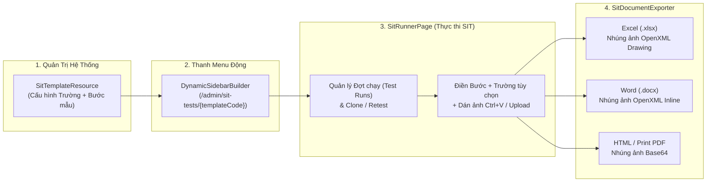

# Kế Hoạch Triển Khai Module SIT Test Builder & Runner (Tùy Biến Bước, Dán Ảnh `Ctrl+V` & Xuất `.xlsx` / `.docx` Nhúng Ảnh)

> **Bối cảnh & Mục tiêu**:
> - Kế thừa kiến trúc `CustomView` + `ReportRunnerPage` của SmartReport (Laravel 13 + Filament 5 + SQLite Config Store).
> - Thay thế quy trình ghi kết quả kiểm thử SIT thủ công trên Word/Excel bằng hệ thống **SIT Template Builder** (định nghĩa bộ trường bước + bước mẫu, gắn lên Sidebar) và **SIT Test Runner** (ghi nhận nhiều đợt chạy, thêm/sửa bước và trường tùy chọn, dán ảnh trực tiếp bằng `Ctrl+V` từ Clipboard, và xuất biên bản nghiệm thu ra **Excel `.xlsx`**, **Word `.docx`**, **HTML/PDF** đều có nhúng ảnh thật trong từng bước).

---

## 1. Tổng Quan Kiến Trúc & Luồng Hoạt Động

1. **Thiết kế Kịch bản mẫu (`SitTemplateResource` — Quản trị)**:
   - Cho phép tạo kịch bản SIT mẫu (`template_code`, `template_name`), gắn vào `MenuGroup` để tự động hiển thị trên thanh Sidebar theo phân quyền `RolePermission`.
   - Cấu hình **Bộ trường thông tin của Bước (`step_fields`)** linh hoạt (ví dụ: `Mô tả thao tác`, `Dữ liệu đầu vào`, `Kết quả mong đợi`, `Kết quả thực tế`, `Ghi chú`, hoặc bất kỳ trường `text | textarea | select` tùy chỉnh nào).
   - Khai báo sẵn **Danh sách Bước mẫu (`default_steps`)** để mỗi lần chạy test không phải gõ lại từ đầu.
2. **Trang Thực Thi & Ghi Nhận SIT (`SitRunnerPage` tại `/admin/sit-tests/{templateCode}`)**:
   - **Quản lý nhiều Đợt chạy (`SitTestRun`)**: Tạo đợt test mới từ Template, xem lịch sử các đợt trước, hoặc bấm **"Nhân bản / Retest"** từ đợt cũ (giữ nguyên các bước đã làm để chỉ sửa lại các bước `FAIL`).
   - **Tùy biến bước linh hoạt khi chạy**: Ngoài các trường chuẩn từ Template, người test có thể **thêm/xóa/sắp xếp bước**, gắn trạng thái từng bước (`PENDING | PASS | FAIL | BLOCKED`), và bấm **"+ Thêm trường thông tin phụ"** (`extra_fields`) cho bất kỳ bước nào.
   - **Bằng chứng Hình ảnh (`Ctrl+V` Clipboard Paste + Upload nhiều ảnh + Chú thích)**:
     - Bấm vào khung Bước và nhấn **`Ctrl+V`** để dán thẳng ảnh chụp màn hình từ Clipboard (`Win+Shift+S`), hoặc chọn/kéo thả nhiều file ảnh, nhập chú thích (`caption`) cho từng ảnh.
3. **Bộ Xuất Biên Bản SIT Nhúng Ảnh Thật (`SitDocumentExporter`)**:
   - Dùng trực tiếp `ZipArchive` chuẩn OpenXML của PHP 8.3 (không cần cài thêm thư viện ngoài) để xuất:
     - **Excel (`.xlsx`)**: Nhúng ảnh thật (`xl/drawings/drawing1.xml` + `xl/media/*`) trực tiếp vào cột Bằng chứng (Evidence) của đúng dòng bước test, tự động giãn chiều cao dòng (`ht`) theo kích thước và số lượng ảnh.
     - **Word (`.docx`)**: Nhúng ảnh thật (`word/document.xml` + `word/media/*`) trình bày theo cấu trúc Biên bản nghiệm thu SIT chuyên nghiệp (Thông tin đợt test, Bảng tổng hợp PASS/FAIL, và chi tiết từng bước kèm ảnh kích thước lớn rõ nét).
     - **HTML / In PDF (`.html`)**: File biên bản độc lập nhúng ảnh Base64 để mở xem ngay trên trình duyệt hoặc bấm `Ctrl+P` lưu PDF.



---

## 2. Nguyên Tắc Thiết Kế Tinh Gọn (Zero Bloat)

- **Không cài đặt thêm package Composer bên thứ 3**: Toàn bộ tính năng xuất `.xlsx` và `.docx` có nhúng ảnh thật được xây dựng bằng `ZipArchive` + `XMLWriter` + `getimagesize()` có sẵn trong PHP 8.3 stdlib, đảm bảo nhẹ, nhanh và không phát sinh xung đột dependency.
- **Lưu trữ ảnh SIT**: Các ảnh dán qua `Ctrl+V` hoặc upload được lưu tại `storage/app/public/sit-evidence/{run_id}/` (kèm symlink `public/storage` hoặc route hiển thị ảnh nội bộ có kiểm tra đăng nhập) để vừa hiển thị tức thời trên giao diện vừa đọc binary trực tiếp khi đóng gói `.xlsx` / `.docx`.

---

## 3. Chi Tiết Các Cụm Thành Phần Triển Khai

### Thành phần 1: Database Schema & Models (`SitTemplate`, `SitTestRun`)

#### 1.1. [NEW] `database/migrations/2026_11_19_000001_create_sit_templates_table.php`
- Bảng `sit_templates`:
  - `id`, `template_code` (unique), `template_name`, `menu_group_code` (nullable, liên kết `menu_groups.group_code`), `module_name`, `description`, `version` (default `'1.0.0'`).
  - `step_fields` (JSON): Danh sách định nghĩa các trường của mỗi bước:
    `[{ "key": "action", "label": "Thao tác thực hiện", "type": "textarea", "required": true }, { "key": "test_data", "label": "Dữ liệu đầu vào", "type": "textarea" }, { "key": "expected", "label": "Kết quả mong đợi", "type": "textarea" }, { "key": "actual", "label": "Kết quả thực tế", "type": "textarea" }]`.
  - `default_steps` (JSON): Danh sách các bước mẫu khởi tạo sẵn (`step_no`, `title`, và giá trị mặc định của các `step_fields`).
  - `roles` (JSON), `is_active` (boolean), timestamps.

#### 1.2. [NEW] `database/migrations/2026_11_19_000002_create_sit_test_runs_table.php`
- Bảng `sit_test_runs`:
  - `id`, `sit_template_id` (foreign key `cascadeOnDelete`), `run_code` (unique, vd: `SIT-ERP-20261119-01`), `run_title` (vd: `Đợt SIT Lần 1 - Sprint 3`), `environment` (`SIT | UAT | STAGING | PROD`), `tester_name`, `tested_at`, `status` (`IN_PROGRESS | PASSED | FAILED | BLOCKED`), `summary_notes`.
  - `steps_data` (JSON): Lưu toàn bộ danh sách bước của đợt test:
    ```json
    [
      {
        "uid": "step_1",
        "step_no": 1,
        "title": "Đăng nhập và tạo Lệnh sản xuất mới",
        "status": "PASS",
        "fields": {
          "action": "Vào menu Sản xuất -> Tạo lệnh mới",
          "test_data": "Plant = NORTH, Qty = 500",
          "expected": "Lưu thành công, sinh mã PO",
          "actual": "Đã sinh mã PO-2026-0089"
        },
        "extra_fields": [
          { "label": "Mã chứng từ", "value": "PO-2026-0089" }
        ],
        "images": [
          {
            "path": "sit-evidence/1/step1_17320001.png",
            "caption": "Màn hình tạo lệnh sản xuất thành công"
          }
        ]
      }
    ]
    ```
  - `created_by` (nullable user id), timestamps.

#### 1.3. [NEW] `app/Models/SitTemplate.php` & `app/Models/SitTestRun.php`
- Model `SitTemplate`: Cung cấp `defaultStepFields()` trả về bộ trường SIT tiêu chuẩn khi tạo mới, quan hệ `menuGroup()` và `testRuns()`.
- Model `SitTestRun`: Cung cấp hàm tính thống kê nhanh `getMetricsAttribute()` (`total`, `pass`, `fail`, `blocked`, `pending`) và hàm khởi tạo `steps_data` từ `SitTemplate` hoặc clone từ một `SitTestRun` trước đó.

---

### Thành phần 2: Quản Trị SIT Template & Tích Hợp Thanh Sidebar Động

#### 2.1. [NEW] `app/Filament/Resources/SitTemplateResource.php` (+ `ListSitTemplates`, `CreateSitTemplate`, `EditSitTemplate`)
- Đặt trong nhóm `Quản Trị Hệ Thống`:
  - **Section 1**: Thông tin kịch bản (`template_code`, `template_name`, `menu_group_code`, `module_name`, `version`, `is_active`, `description`).
  - **Section 2**: Repeater **Cấu hình các trường thông tin của Bước (`step_fields`)** — mặc định điền sẵn 4 trường chuẩn (`Thao tác`, `Dữ liệu test`, `Kết quả mong đợi`, `Kết quả thực tế`), cho phép Admin thêm/sửa/xóa trường (`key`, `label`, `type`: `text | textarea | select`, `options`, `required`).
  - **Section 3**: Repeater **Danh sách Bước mẫu (`default_steps`)** — định nghĩa trước tiêu đề bước và nội dung hướng dẫn/mong đợi cho từng bước.
  - **Section 4**: Phân quyền `roles` (tương tự `CustomViewResource`).
  - Nút Action trên bảng danh sách: **"Mở trang Test SIT"** chuyển thẳng tới `/admin/sit-tests/{template_code}`.

#### 2.2. [MODIFY] `app/Services/Navigation/DynamicSidebarBuilder.php`
- Trong `buildReportGroups(User $user)`:
  - Bên cạnh các `CustomView` thuộc từng `MenuGroup`, nạp thêm các `SitTemplate` (`is_active = true`) thuộc `MenuGroup` đó với đường dẫn `/admin/sit-tests/{template_code}` và icon phân biệt rõ kịch bản SIT.

---

### Thành phần 3: Trang Thực Thi & Ghi Nhận SIT (`SitRunnerPage`) Với `Ctrl+V` Paste Ảnh

#### 3.1. [NEW] `app/Filament/Pages/SitRunnerPage.php` & `resources/views/filament/pages/sit-runner-page.blade.php`
- Route: `/admin/sit-tests/{templateCode}`.
- **Thanh điều khiển Đợt chạy (Test Run Bar)**:
  - Dropdown chọn **Đợt chạy (`SitTestRun`)** hiện tại + Badge tổng hợp tiến độ (`Tổng số bước`, `PASS`, `FAIL`, `BLOCKED`, `PENDING`).
  - Nút **"+ Tạo đợt test mới"** (khởi tạo từ `default_steps` của Template).
  - Nút **"Nhân bản / Retest đợt này"** (copy toàn bộ các bước của đợt đang chọn sang đợt mới để retest nhanh).
  - Nút **"Lưu kết quả"**, **"Xuất Excel (`.xlsx`)"**, **"Xuất Word (`.docx`)"**, **"Xem / In HTML"**.
- **Danh sách Bước kiểm thử (Interactive Step Cards)**:
  - Mỗi bước hiển thị dạng Card rõ ràng, có thể thu gọn/mở rộng, đổi thứ tự (Lên/Xuống), xóa bước hoặc **"+ Thêm bước mới"**.
  - Bộ chọn trạng thái bước (`PASS` xanh lá, `FAIL` đỏ, `BLOCKED` cam, `PENDING` xám).
  - Tự động render các ô nhập liệu theo `step_fields` của Template + danh sách **"Thông tin bổ sung (`extra_fields`)"** (cho phép bấm `+ Thêm thông tin` để điền cặp `Tên trường: Giá trị` tùy ý cho riêng bước đó).
  - **Khung Bằng chứng Hình ảnh (`Ctrl+V` & Upload)**:
    - Hỗ trợ sự kiện `paste` (`Ctrl+V`) trực tiếp từ Clipboard (chuyển `ClipboardItem` ảnh sang base64/upload Livewire lưu thành file PNG trong `storage/app/public/sit-evidence/{runId}/`) và nút chọn nhiều file ảnh từ máy.
    - Hiển thị lưới ảnh thumbnail ngay trong bước, cho phép nhập `Chú thích ảnh (Caption)`, bấm xem ảnh phóng to (Lightbox), hoặc xóa ảnh.

---

### Thành phần 4: Bộ Xuất File `.xlsx`, `.docx` & `.html` Nhúng Ảnh Thật (`SitDocumentExporter`)

#### 4.1. [NEW] `app/Services/Export/SitDocumentExporter.php`
1. **`exportExcel(SitTemplate $template, SitTestRun $run): string` (Chuẩn OpenXML `.xlsx` có nhúng ảnh)**:
   - Tạo gói `.xlsx` qua `ZipArchive`:
     - Phần đầu sheet: Bảng thông tin chung của kịch bản & đợt chạy SIT (`Tên kịch bản`, `Mã đợt test`, `Môi trường`, `Người test`, `Ngày test`, `Tổng kết PASS/FAIL`).
     - Bảng chi tiết các bước: Cột `Bước #`, `Tiêu đề bước`, `Trạng thái`, các cột động từ `step_fields`, cột `Thông tin bổ sung`, và cột **`Hình ảnh bằng chứng (Evidence)`**.
     - Với các bước có ảnh: Lưu file ảnh vào `xl/media/image{N}.{ext}`, khai báo `xl/drawings/drawing1.xml` với `<xdr:oneCellAnchor>` gắn chính xác vào tọa độ `(col, row)` của bước đó, tính toán kích thước EMU từ `getimagesize()` và tự động tăng chiều cao dòng Excel (`ht`) để ảnh nằm gọn trong ô, không bị đè lên nhau.
2. **`exportWord(SitTemplate $template, SitTestRun $run): string` (Chuẩn OpenXML `.docx` có nhúng ảnh)**:
   - Tạo gói `.docx` qua `ZipArchive`:
     - Trang bìa/tiêu đề Biên bản Kiểm thử Tích hợp Hệ thống (SIT), bảng Metadata & Thống kê kết quả.
     - Trình bày lần lượt từng Bước kiểm thử (Bảng thông tin bước + các trường tùy chọn + danh sách hình ảnh bằng chứng nhúng qua `<w:drawing><wp:inline>...<a:blip r:embed="rIdImgN"/>` kèm dòng chú thích dưới mỗi ảnh).
3. **`exportHtml(SitTemplate $template, SitTestRun $run): string`**:
   - Xuất file `.html` độc lập nhúng ảnh Base64 (`data:image/png;base64,...`) kèm CSS chuẩn in A4 để mở xem ngay hoặc in ra PDF.

---

### Thành phần 5: Dữ Liệu Mẫu (`SmartReportSeeder`)

#### 5.1. [MODIFY] `database/seeders/SmartReportSeeder.php`
- Seed sẵn 1 kịch bản SIT mẫu (`sit-erp-order-sync` — *Kiểm thử SIT Đồng bộ Đơn hàng & Sản xuất ERP*) kèm 1 Đợt chạy mẫu có sẵn 3 bước và ảnh PNG mẫu để có thể trải nghiệm và kiểm thử xuất file ngay lập tức.

---

## 4. Kế Hoạch Kiểm Thử & Nghiệm Thu (Verification Plan)

### 4.1. Automated Tests (`tests/Feature/SitModuleAndExporterTest.php`)
1. Tạo `SitTemplate` qua `SitTemplateResource` với các trường bước tùy chỉnh (`step_fields`) và bước mẫu (`default_steps`), xác nhận hiển thị trên `DynamicSidebarBuilder`.
2. Mở `SitRunnerPage`, tạo `SitTestRun` mới, cập nhật giá trị trường, thêm trường tùy chọn (`extra_fields`), thêm bước mới, dán ảnh Base64 (`Ctrl+V` paste handler) và upload ảnh cho bước test.
3. Kiểm tra tính năng **Nhân bản / Retest (`cloneRun`)** giữ nguyên dữ liệu các bước và ảnh bằng chứng sang đợt chạy mới.
4. Kiểm tra xuất file **Excel (`.xlsx`)**: Xác nhận file ZIP OpenXML hợp lệ, chứa `xl/worksheets/sheet1.xml`, `xl/drawings/drawing1.xml`, và chứa đúng các file ảnh binary trong `xl/media/`.
5. Kiểm tra xuất file **Word (`.docx`)**: Xác nhận file ZIP OpenXML hợp lệ, chứa `word/document.xml` (có thẻ `<a:blip>`), và chứa đúng các file ảnh binary trong `word/media/`.

```bash
cd /home/v25050017/project/laravel/DAR/SmartReport
php artisan test --filter=SitModuleAndExporterTest
vendor/bin/pint --dirty --format agent
php artisan test
```
